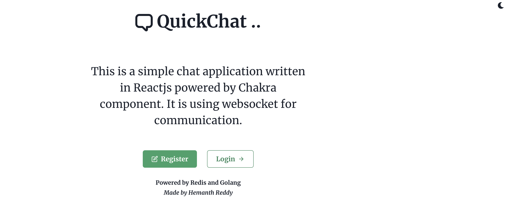

# Real-Time Chat Service (QuickChat)

A one-to-one real-time chat app with a **Go** backend and a **React** frontend. Messages are sent over **WebSockets**, and users, chats and contact lists are stored in **Redis**.



## Features

- Register and log in with a username and password
- Add a contact by username; the contact must already be registered
- Real-time one-to-one messaging over WebSockets
- Chat history between two users, newest first
- Contact list sorted by most recent activity
- Light and dark mode (Chakra UI)

## Architecture

The backend is one Go binary that runs in one of two modes, chosen with the `--server` flag:

```
 ┌──────────────┐   REST (register, login,      ┌────────────────────────┐
 │              │   contacts, history)          │  HTTP server :8080     │
 │              │ ────────────────────────────► │  --server=http         │───┐
 │ React client │                               │  (also serves the      │   │
 │    :3000     │                               │   built React app)     │   │    ┌─────────┐
 │              │                               └────────────────────────┘   ├──► │  Redis  │
 │              │   WebSocket                   ┌────────────────────────┐   │    │  :6379  │
 │              │ ◄───────────────────────────► │  WebSocket server :8081│───┘    └─────────┘
 │              │   ws://localhost:8081/ws      │  --server=websocket    │
 └──────────────┘                               └────────────────────────┘
```

### Message flow

1. When the chat page opens, the client connects to `ws://localhost:8081/ws` and sends `{"type":"bootup","user":"<username>"}`. This links the connection to the user.
2. To send a message, the client sends `{"type":"message","chat":{"from":"alice","to":"bob","message":"hi"}}`.
3. The WebSocket server stamps the message with the current time, saves it in Redis, and updates both users' contact lists.
4. A broadcaster goroutine pushes the saved message to every open connection belonging to the sender or the recipient.

### Redis data model

| Key | Type | Purpose |
|---|---|---|
| `users` | Set | All registered usernames |
| `<username>` | String | That user's password |
| `chat#<unix-ms>` | String (JSON) | One chat message |
| `lookup:<from>:<to>:<ts>` | String | Points to a `chat#…` key; written in both directions so history can be fetched either way |
| `contacts:<username>` | Sorted set | The user's contacts, scored by last-activity time |

## Tech stack

| Layer | Technology |
|---|---|
| Backend | Go 1.17+, gorilla/mux, gorilla/websocket, rs/cors, joho/godotenv |
| Storage | Redis (go-redis v8) |
| Frontend | React 18, Chakra UI, React Router 6, Axios |

## Project structure

```
.
├── main.go                  # Entry point: --server=http | --server=websocket
├── model/chat.go            # Chat and ContactList types
├── pkg/
│   ├── httpserver/          # REST API + static file server (:8080)
│   ├── ws/websocket.go      # WebSocket server and broadcaster (:8081)
│   └── redisrepo/           # Redis client, key naming, queries
└── client/                  # React app (Create React App)
    ├── src/
    │   ├── socket-connection.js
    │   └── Components/      # Landing, Login, Register, Chat/*
    └── build/               # Pre-built production bundle
```

> **Note:** the source is currently in `Quick_Chat-main.zip` in this repo. Unzip it to get the layout above.

## Getting started

### Prerequisites

- Go 1.17 or newer
- Node.js 16 or newer, with npm
- Redis running on `localhost:6379` (for example, `docker run -d -p 6379:6379 redis:7`)

### 1. Configure environment

Create a `.env` file in the project root. The server won't start without it.

```env
REDIS_CONNECTION_STRING=localhost:6379
# Optional, only if your Redis needs a password:
# REDIS_PASSWORD=yourpassword
```

### 2. Install dependencies

```bash
go mod download
cd client && npm install && cd ..
```

### 3. Run

Use three terminals:

```bash
# Terminal 1: REST API
go run main.go --server=http

# Terminal 2: WebSocket server
go run main.go --server=websocket

# Terminal 3: React dev server
cd client && npm start
```

Open **http://localhost:3000**, register two users (use two browsers or a private window for the second), add each other as contacts, and start chatting.

You can skip the React dev server: the HTTP server also serves the pre-built app from `client/build` at **http://localhost:8080**. Rebuild it with `cd client && npm run build` after making frontend changes.

## API reference

### REST (port 8080)

| Method | Path | Body / Query | Description |
|---|---|---|---|
| `POST` | `/register` | `{"username":"alice","password":"secret"}` | Create a user |
| `POST` | `/login` | `{"username":"alice","password":"secret"}` | Check credentials |
| `POST` | `/verify-contact` | `{"username":"bob"}` | Check whether a user exists |
| `GET` | `/contact-list` | `?username=alice` | Contacts sorted by last activity |
| `GET` | `/chat-history` | `?u1=alice&u2=bob[&from-ts=…&to-ts=…]` | Messages between two users, newest first |

Every endpoint returns:

```json
{ "status": true, "message": "", "data": [], "total": 0 }
```

### WebSocket (port 8081)

Endpoint: `ws://localhost:8081/ws`

| Direction | Payload |
|---|---|
| Client → server | `{"type":"bootup","user":"alice"}` |
| Client → server | `{"type":"message","chat":{"from":"alice","to":"bob","message":"hello"}}` |
| Server → client | `{"id":"chat#…","from":"alice","to":"bob","message":"hello","timestamp":1700000000}` |

## Testing

The tests in `pkg/redisrepo` talk to a real Redis, configured through `.env`:

```bash
go test ./pkg/redisrepo/ -v
```

`TestIndexExist` and `TestCreateSortableIndex` need the RediSearch module and fail on plain Redis.

## Known limitations

- **Single WebSocket instance:** connected clients are tracked in memory, so messages only reach users connected to the same WebSocket server. Running more than one instance would need a message bus, such as Redis Pub/Sub.
- **Not production-safe auth:** passwords are stored in plain text and compared case-insensitively, and there are no sessions or tokens.
- **History lookup uses `KEYS`:** this scans the whole keyspace and slows down as data grows. A sorted set per conversation would scale better.
- **Hard-coded URLs:** the client points to `localhost:8080` and `localhost:8081`, so deploying it elsewhere means editing `client/src`.
